<h2 align="center">Full-Stack &amp; Web Development, built on best practices</h2>

  We design, build and ship web products end to end — from pixel-perfect interfaces to APIs, databases, smart contracts and cloud infrastructure. 
  Our core languages are TypeScript, JavaScript, Python, PHP, SQL, Rust and Solidity. 
  Clean architecture, type safety, tests and automated delivery are the default, not an extra.

  

### 🛠️ Tech stack

<!-- stack:start -->
<table align="center">
  <tr>
    <td align="right"><b>Languages</b></td>
    <td>
      
      
      
      
      
      
      
      
      
    </td>
  </tr>
  <tr>
    <td align="right"><b>Frontend</b></td>
    <td>
      
      
      
      
      
      
      
      
      
    </td>
  </tr>
  <tr>
    <td align="right"><b>Backend</b></td>
    <td>
      
      
      
      
      
      
      
      
    </td>
  </tr>
  <tr>
    <td align="right"><b>Databases</b></td>
    <td>
      
      
      
      
    </td>
  </tr>
  <tr>
    <td align="right"><b>Cloud &amp; DevOps</b></td>
    <td>
      
      
      
      
      
      
      
      
      
    </td>
  </tr>
  <tr>
    <td align="right"><b>Tools</b></td>
    <td>
      
      
      
      
      
      
    </td>
  </tr>
  <tr>
    <td align="right"><b>IDEs</b></td>
    <td>
      
      
      
      
    </td>
  </tr>
</table>
<!-- stack:end -->

### ⚡ How we work

| | |
|---|---|
| 🧱 **Clean architecture** | SOLID, modular design, readable code that is easy to change |
| 🛡️ **Type-safe & secure** | TypeScript-first, input validation, OWASP-aware APIs |
| ✅ **Tested & automated** | Unit / e2e tests, CI/CD pipelines, code review on every change |
| 🚀 **Fast by default** | Core Web Vitals, SEO, caching and CDN at the edge |
| ☁️ **Production-ready** | Docker containers, monitoring and zero-downtime deploys |

### 📦 Featured projects

<table>
  <tr>
    <th width="28%" align="left">Project</th>
    <th align="left">What it is</th>
    <th align="left">Stack</th>
  </tr>
  <tr>
    <td><a href="https://github.com/lpcms/indicator_boxinside_tw"><b>indicator_boxinside_tw</b></a></td>
    <td>BoxInside — per-candle volume profile for TradingView with POC and VAH / VAL value-area borders, ported from MetaTrader 4</td>
    <td>Pine&nbsp;Script</td>
  </tr>
  <tr>
    <td><a href="https://github.com/lpcms/btc-liquidation"><b>btc&#8209;liquidation</b></a></td>
    <td>Real-time BTCUSDT perpetual chart with every liquidation drawn as a bubble at its price and time</td>
    <td>TypeScript</td>
  </tr>
  <tr>
    <td><a href="https://github.com/lpcms/crypto-orderbook"><b>crypto&#8209;orderbook</b></a></td>
    <td>Real-time crypto order book · <a href="https://crypto-orderbook-sandy.vercel.app">live demo</a></td>
    <td>TypeScript</td>
  </tr>
  <tr>
    <td><a href="https://github.com/lpcms/wallet-graph"><b>wallet&#8209;graph</b></a></td>
    <td>Crypto wallet relationship graph</td>
    <td>TypeScript</td>
  </tr>
  <tr>
    <td><a href="https://github.com/lpcms/p2p-scanner-dex-cex"><b>p2p&#8209;scanner&#8209;dex&#8209;cex</b></a></td>
    <td>P2P price scanner across DEX &amp; CEX · <a href="https://p2p-scanner-dex-cex.vercel.app">live demo</a></td>
    <td>TypeScript</td>
  </tr>
  <tr>
    <td><a href="https://github.com/lpcms/gocar"><b>gocar</b></a></td>
    <td>Commercial car rental &amp; booking platform</td>
    <td>TypeScript</td>
  </tr>
</table>

  <picture>
    <source media="(prefers-color-scheme: dark)" srcset="https://raw.githubusercontent.com/lpcms/lpcms/output/snake-dark.svg"/>
    
  </picture>

<h3 align="center">🤝 Connect</h3>

  
  
  

