<h2 align="center">Full-Stack &amp; Web Development, built on best practices</h2>

  We design, build and ship web products end to end — from pixel-perfect interfaces to APIs, databases and cloud infrastructure. 
  Clean architecture, type safety, tests and automated delivery are the default, not an extra.

  

### ⚡ How we work

| | |
|---|---|
| 🧱 **Clean architecture** | SOLID, modular design, readable code that is easy to change |
| 🛡️ **Type-safe & secure** | TypeScript-first, input validation, OWASP-aware APIs |
| ✅ **Tested & automated** | Unit / e2e tests, CI/CD pipelines, code review on every change |
| 🚀 **Fast by default** | Core Web Vitals, SEO, caching and CDN at the edge |
| ☁️ **Production-ready** | Containers, Kubernetes, monitoring and zero-downtime deploys |

### 🛠️ Tech stack

<table align="center">
  <tr>
    <td align="right"><b>Languages</b></td>
    <td></td>
  </tr>
  <tr>
    <td align="right"><b>Frontend</b></td>
    <td></td>
  </tr>
  <tr>
    <td align="right"><b>Backend</b></td>
    <td></td>
  </tr>
  <tr>
    <td align="right"><b>Databases</b></td>
    <td></td>
  </tr>
  <tr>
    <td align="right"><b>Cloud &amp; DevOps</b></td>
    <td></td>
  </tr>
  <tr>
    <td align="right"><b>Tools</b></td>
    <td></td>
  </tr>
  <tr>
    <td align="right"><b>IDEs</b></td>
    <td></td>
  </tr>
</table>

### 📦 Featured projects

| Project | What it is | Stack |
|---|---|---|
| [**btc-liquidation**](https://github.com/lpcms/btc-liquidation) | Real-time BTCUSDT perpetual chart with every liquidation drawn as a bubble at its price and time | TypeScript |
| [**crypto-orderbook**](https://github.com/lpcms/crypto-orderbook) | Real-time crypto order book | TypeScript |
| [**wallet-graph**](https://github.com/lpcms/wallet-graph) | Crypto wallet relationship graph | TypeScript |
| [**p2p-scanner-dex-cex**](https://github.com/lpcms/p2p-scanner-dex-cex) | P2P price scanner across DEX &amp; CEX | TypeScript |
| [**gocar**](https://github.com/lpcms/gocar) | Commercial car rental &amp; booking platform | TypeScript |

  <picture>
    <source media="(prefers-color-scheme: dark)" srcset="https://raw.githubusercontent.com/lpcms/lpcms/output/snake-dark.svg"/>
    
  </picture>

<h3 align="center">🤝 Connect</h3>

  
  
  

